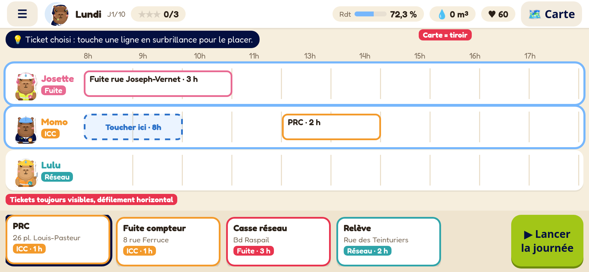
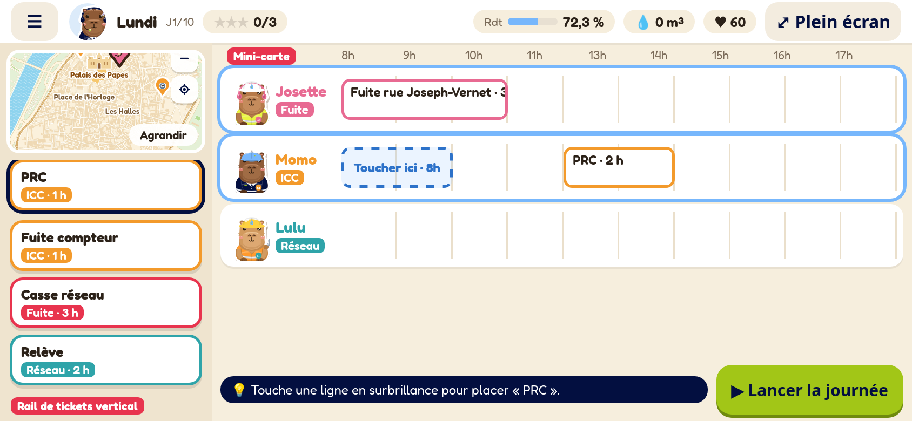

# Écran de planning : refonte mobile (option A + mini-carte de l’option B, implémentée)

Cible principale : smartphone en paysage (iPhone 844×390, 932×430, 667×375, et beaucoup moins de hauteur
quand Safari affiche ses barres, environ 320 à 340 px). Aujourd'hui l'en-tête prend environ 52 px, la carte occupe 37 % de la largeur
en permanence, la bulle du tutoriel recouvre la carte et le bac de tickets peut sortir de l'écran (corrigé à part
dans `aa4d271` : les lignes défilent et le bac reste visible).

Points communs aux deux options :

- **Barre du haut fine (40 px)** : menu, avatar, jour, étoiles d'objectifs et les KPI en pastilles compactes
  (rendement, pertes, abonnés). Toucher une pastille ouvre le détail.
- **Toucher pour choisir, puis toucher le créneau** comme geste principal : le ticket choisi se soulève, les lignes
  compatibles s'allument et un créneau fantôme « Toucher ici · 8h » s'affiche. On garde le glisser-déposer en plus.
- **Le tutoriel en bandeau court** au-dessus du planning ou à côté du bouton, jamais posé sur le contenu.
- **Zones tactiles ≥ 44 px** partout, lignes de 58 à 74 px de haut, tickets de 150 px ou plus.
- **Le bac de tickets toujours visible**, placé dans la zone sûre (`safe-area-inset-bottom`), avec un défilement
  dans un seul sens.

## Option A : planning pleine largeur, carte en tiroir

Le planning occupe toute la largeur. La carte s'ouvre en tiroir par la gauche (bouton « Carte », ou toucher
l'adresse d'un ticket : le tiroir s'ouvre centré sur le point). Le bac de tickets est fixé en bas et défile
horizontalement ; le bouton « Lancer la journée » est à droite.

- Pour : le plus de place pour la frise horaire (créneaux d'1 h d'environ 70 px au lieu de 45), cibles plus grandes,
  lecture la plus simple. C'est le changement le plus léger par rapport au code actuel : `.mapbox` devient un
  tiroir en overlay.
- Contre : la carte n'est plus visible en permanence, donc la géographie et les trajets se lisent moins d'un coup
  d'œil (il faudrait une petite indication de distance sur les tickets, par ex. « 8 min »). Il faut ouvrir le tiroir
  pendant la journée pour suivre les camionnettes.

## Option B : rail de tickets vertical et mini-carte

La colonne de gauche (environ 196 px) contient une mini-carte (que l'on touche pour l'agrandir en plein écran)
et, dessous, les tickets en liste verticale qui défile. Le planning occupe la droite ; le tutoriel et le bouton
de lancement sont en bas.

- Pour : la carte reste visible (on suit les camionnettes en mode lecture), les tickets ont plus de hauteur que
  dans un bac horizontal et la liste peut en afficher 4 ou 5 sans défiler. Le défilement vertical est naturel au pouce.
- Contre : la frise horaire est un peu moins large que dans l'option A. La mini-carte est petite (elle sert à
  repérer les lieux, pas à travailler dessus). La refonte de la mise en page est un peu plus lourde.

## Variante portrait (les deux options)

En portrait : barre fine en haut, planning en dessous (lignes plus hautes), puis le bac de tickets horizontal et
le bouton en bas ; la carte s'ouvre en feuille modale. Le message « Tourne ton téléphone » ne s'afficherait plus
qu'en dessous de 600 px de haut.

## Recommandation

L'**option A** pour la phase de planification (la frise passe avant tout), avec la mini-carte de l'option B
réutilisée pendant la journée en cours (le bac est alors remplacé par le fil d'événements et les contrôles x1/x2).
Validée par Maxime et implémentée : barre fine, planning pleine largeur, carte en tiroir (bouton « Carte »), bac de tickets toujours visible, créneau fantôme « Toucher ici », tutoriel en bandeau au-dessus du planning, mini-carte pendant la journée (bouton pour l’agrandir). Tablette et ordinateur gardent la carte à gauche.

Maquettes HTML : `docs/mockups/option-a.html`, `docs/mockups/option-b.html` (rendu WebKit 844×390).
